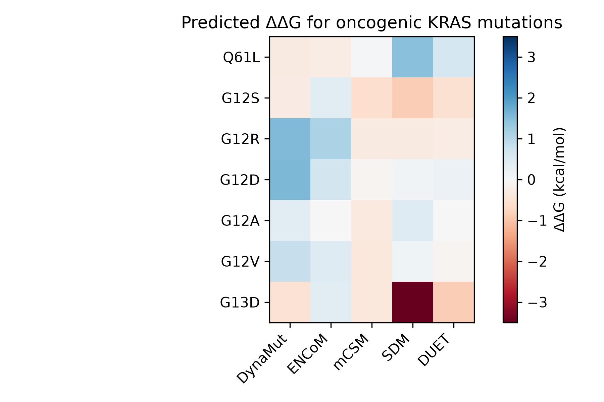

# KRAS stability predictors

A small analysis comparing five protein stability predictors on seven oncogenic KRAS mutations.

## Background
In my undergraduate poster (Toofi et al., 2025, doi:10.5281/zenodo.21456758), I used the DynaMut server to estimate how seven oncogenic KRAS mutations affect protein stability. The five methods it reports often gave different answers for the same mutation. This repository looks at that disagreement more systematically.

## What the notebook does
1. Loads ΔΔG predictions from DynaMut, ENCoM, mCSM, SDM and DUET for G12S, G12R, G12D, G12A, G12V, G13D and Q61L.
2. Calculates, for each mutation, the range between the highest and lowest prediction.
3. Counts how many predictors call each mutation stabilizing or destabilizing.
4. Plots the predictions as a heatmap.

## Main findings
- No mutation received the same direction from all five predictors. The best agreement was for G12D (4 of 5).
- G13D had the largest disagreement (range 3.889 kcal/mol), mainly because SDM predicted −3.5 kcal/mol.
- Most values were small, so single-tool predictions should be interpreted with caution.

## Limitations
- Only seven mutations were analyzed.
- The predictions were not compared with experimental data.

## Files
- `analysis.ipynb`: the full analysis
- `kras_ddg_predictions.csv`: the input data
- `ddg_heatmap.png`: the heatmap

## Requirements
Python 3 with pandas and matplotlib.

## Author
Ava Toofi, M.Sc. student in Biotechnology, University of Tehran. I am learning Python, and this is one of my first analysis projects.
